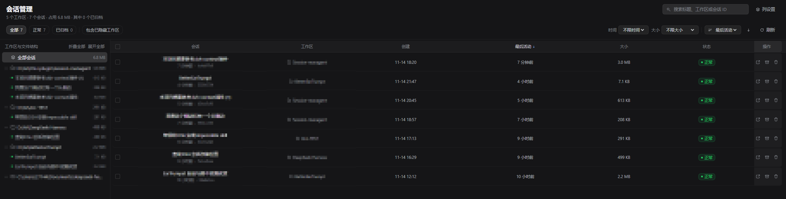
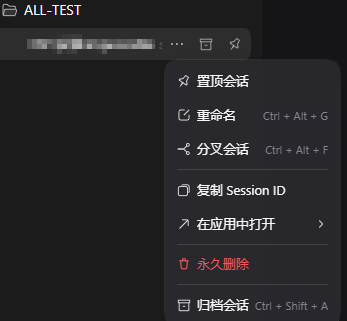
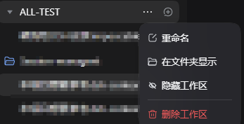

# 会话管理 · dsh-session-manager

> 给 DeepSeek Harness 加一张会话与工作区的总览表。

DeepSeek Harness（以下简称 DSH）的侧栏按会话逐条排列。工作区与会话一多，就很难回答「哪个目录占了 3.2 MB」「哪些会话是上个月开的、早该归档」「这十个旧会话能不能一次清掉」这类问题。

`dsh-session-manager` 在左侧栏新增一个选项卡，把这些信息摊成一张可筛选、可排序、可批量处理的表，同时给宿主原生的会话菜单和工作区菜单各追加一项，让「永久删除会话」与「隐藏工作区」这两个宿主未提供的操作可以在原地完成。

它不替换宿主的任何界面，也不改动宿主的数据结构：新增菜单项插在原位，原生项（重命名、在文件夹显示、置顶、分叉、复制 Session ID、归档等）一项未动。



> 截图中的会话标题、工作区路径与会话 ID 已做打码处理。

## 目录

- [功能特性](#功能特性)
- [界面](#界面)
- [交互设计](#交互设计)
- [安装](#安装)
- [使用场景](#使用场景)
- [数据安全](#数据安全)
- [工作原理](#工作原理)
- [兼容性](#兼容性)
- [已知限制](#已知限制)
- [开发](#开发)
- [文档](#文档)
- [贡献](#贡献)
- [许可](#许可)

## 功能特性

- **一张表看全**：所有工作区与会话（含不归属任何工作区的「未分类」）在同一张表里，每行给出标题、工作区、创建时间、最后活动、磁盘占用与状态。
- **占用可以拆开看**：大小按会话整个目录统计（日志历史代 + 投影缓存），悬停可看到两者各占多少。
- **筛选**：状态（全部 / 正常 / 已归档，计数随其它条件实时联动）、时间范围（不限 / 近 7 天 / 近 30 天）、大小区间（不限 / 小于 1 MB / 1–100 MB / 大于 100 MB）、是否包含已隐藏工作区。
- **搜索**：匹配标题、工作区路径与会话 ID 前缀，命中片段高亮。
- **排序**：点击表头按该列排序，再点一次翻转方向，当前列显示 ↑/↓。
- **批量操作**：勾选后按选择内容给出归档、取消归档、永久删除。
- **列可定制**：拖动排序、勾选显隐、拖拽改宽，以及「按字段名分配宽度」一键铺满可用空间；配置保存在本机。
- **工作区树**：按目录分组并汇总占用；点一次展开、再点折回，右上角一个按钮统管全部；已隐藏的工作区单独成组，可一键恢复。
- **原生菜单扩展**：会话菜单追加「永久删除」，工作区菜单追加「隐藏工作区」。
- **深色 / 浅色**：两套配色分别调过对比度，跟随宿主主题即时切换，原生下拉与滚动条同步。

## 界面

### 侧栏入口

安装并启用后，左侧栏多出「会话管理」条目（与「插件」「自动化任务」「上下文洞察」并列），点击即在本页签打开管理页。


### 页面构成

**页头**：标题与一行汇总（工作区数 · 会话数 · 总占用 · 其中已归档数）；右侧为搜索框与「列设置」。

**筛选栏**：左侧是状态切换与「包含已隐藏工作区」开关，右侧是时间范围、大小区间、排序字段、升降序按钮与刷新。

**左侧工作区树**：「全部会话」/ 各工作区 /「未分类」，节点显示路径与占用大小；底部「已隐藏」分组列出被隐藏的工作区，可一键恢复。

**右侧会话表**：

| 列 | 内容 |
| --- | --- |
| 勾选框 | 选择单行；表头那个是全选当前视图 |
| 会话 | 标题（最多三行，超出省略，悬停看全文）+ 相对时间 · 会话 ID 前缀 |
| 工作区 | 工作区短名，隐藏状态的工作区会标记出来 |
| 创建 | 绝对时间（今天 HH:mm / MM-DD） |
| 最后活动 | 相对时间，每分钟自动重算 |
| 大小 | 该会话**整个目录**的占用，含日志历史代与投影缓存；悬停显示「日志 x · 投影缓存 y」 |
| 状态 | 正常 / 已归档 / 运行中 |
| 操作 | 打开会话、归档或取消归档、永久删除 |

**批量栏**：勾选任意一条即浮出，显示条数与总大小，并按选择内容提供归档、取消归档、永久删除、取消选择。

**脚注**：当前显示条数 / 总数。

### 会话菜单：永久删除



插在「在应用中打开」之后、「归档会话」之前，使用危险色并单独分组，不与归档这类可逆操作混排。执行时会先打开管理页，再走与批量删除完全相同的确认流程：勾选「我已备份需要保留的内容」，单次删除超过 10 个还需输入数量。

### 工作区菜单：隐藏工作区



插在「在文件夹显示」之后、「删除工作区」之前，图标为斜杠眼睛。执行时把该工作区名下的会话归档，并把它从工作区注册表摘除（原生侧栏随之不再列出）；不删除任何数据，恢复入口在管理页左侧树的「已隐藏」分组。

> 菜单中的灰色快捷键提示属于宿主原生项；插件新增的这两项没有绑定快捷键。

## 交互设计

以下几处是刻意设计的结果：

- **单击行 = 切换该行的勾选**：再点一次取消，焦点环一并消失，其它已勾选的行不受影响。
- **方向键只移动焦点环**，不改勾选；空格切换光标行的勾选 —— 连续按 ↓ 不会把整屏勾满。
- **打开会话只有两条路径**：行尾「打开」按钮，或键盘 Enter。双击行不触发任何操作。
- **左侧树**：单击工作区选中该范围（右侧列表只显示这棵子树）并展开它，再点一次折回；小三角只表示状态，整行都是点击目标。展开后单击某个会话 = 在右侧表中定位并短暂高亮（不跳转），双击 = 直接进入该会话。
- **拖动列边界只影响相邻两列**：左侧加多少、右侧就减多少，第三列不动；邻居到达自身最小宽度即停。最后的数据列（默认「状态」）吸收剩余宽度，表格始终填满面板。
- **列宽有可读下限**：会话列不小于 160 px，其余列按表头文字长度计算；读到低于下限的旧配置会被抬回下限。
- **列设置**支持拖动排序、勾选显隐（会话列与操作列不可隐藏）、恢复默认，以及「按字段名分配宽度」——按字段名的视觉长度比例分配，每列保底，差额由弹性列吸收。
- **排序**：表头与工具栏的排序控件共享同一份状态。
- **搜索**为前端匹配，不请求后端。
- **刷新**是重新测量：绕开宿主 30 秒缓存重新统计磁盘占用，完成后以 toast 报告条数。
- **主题**：深色与浅色各自调整了分层与对比度，切换即时生效。

## 安装

### 通过 GitHub 安装

在 DSH 的 **插件** 面板中添加插件，填入仓库地址：

```
github:Baisbt/dsh-session-manager
```

安装后在插件列表中启用 `dsh-session-manager`，刷新页面即可在左侧栏看到新选项卡。

### 从本地目录安装（开发用）

克隆仓库到任意目录，在 **插件 → 添加插件** 中选择该目录（需绝对路径）。本地目录安装是「链接」关系，改动文件后重载插件、刷新页面即可看到效果。

### 卸载

在插件面板中停用或移除即可。管理页写入本机的两份记录（列配置、隐藏工作区清单）留在浏览器存储中，不影响宿主数据。

## 使用场景

- **找出最占空间的会话**：按「大小」降序，或用大小区间直接筛出大于 100 MB 的条目。
- **清理长期不用的会话**：按「最后活动」升序排列，最久没动过的排在最前；勾选后批量归档，确认无用再永久删除。
- **只看最近的活动**：时间范围选「近 7 天」或「近 30 天」，列表只留这个窗口内有动静的会话。
- **让侧栏清爽**：把不再参与的工作区「隐藏」，需要时从「已隐藏」分组恢复。
- **调整成顺手的表格**：在列设置里隐藏用不上的列、拖动改宽，或按字段名一键分配。

## 数据安全

会改动数据的操作有三类，动手前值得先看清各自的后果：

| 操作 | 影响 | 可逆性 |
| --- | --- | --- |
| 归档 / 取消归档 | 调用宿主工作区 API，与原生菜单同一实现 | 可逆，原生侧栏同步体现 |
| 永久删除会话 | 删除会话的日志目录（含 `session.v1..v3.jsonl[.zstd]` 历史代）、投影缓存文档，以及工作区注册表中的引用 | **不可逆**，不进回收站，也不进入「已归档」 |
| 隐藏工作区 | 归档其名下的会话 + 从工作区注册表摘除 + 在本机记录路径、标题与会话 ID | 可由「已隐藏」分组的「恢复显示」还原 |

**永久删除**的边界：

- 正在运行的会话会被拒绝，需先停止。
- 附件按内容寻址共享，删除会话不会释放附件空间。
- DSH 内存中的投影缓存不会自动失效，删除后可能需要重启一次。
- 删除完成后本页与原生侧栏会重新拉取会话列表，被删的行立即消失，不会留下「未分组」里的空壳；若在别处（另一个窗口）删了文件，点一次「刷新」也能让列表归位。
- 确认框要求勾选「我已备份需要保留的内容」；单次删除 10 个以上还需输入数量。

**隐藏工作区**的边界：

- 隐藏期间，这些会话处于**归档**状态。
- 当时正在运行的会话会被跳过，留在「未分类」，不丢数据。
- 隐藏记录保存在本机浏览器存储（localStorage）：换浏览器或清缓存会丢失记录；数据本身仍在，工作区会以归档态重新出现。

## 工作原理

插件由两个半边组成，通过同源 HTTP 路由通信：

```
Client 半（client.js）
  左侧栏条目 / 管理页 / 两个菜单项
        │
        │  同源 fetch: api/dsh-session-manager/{stats,delete,hide,restore}
        ▼
Host 半（index.js）
  ├─ sessionPersistence   会话日志、大小与创建时间
  ├─ workspaceRegistry    工作区、会话归属与归档状态
  └─ sessions             运行状态
```

- **Host 半**（`index.js`）通过 `connection.fetch` 注册四条路由：统计、删除、隐藏、恢复。统计读取宿主的会话持久化快照与工作区注册表，结果缓存 30 秒；「刷新」会让请求绕过缓存。
- **Client 半**（`client.js`）通过 `slots` 在 `sidebar.panellist` 与 `main` 两个槽位注册侧栏条目与页面，用 React 渲染整页；另在两处 `contextMenus` 中追加菜单项。
- **通信**采用同源 `fetch`，统一 `{ ok, value }` / `{ ok, error }` 信封；批量操作在插件侧限制并发，逐条汇总成功与失败。

宿主没有提供的能力，插件用宿主已有原语组合实现（例如删除会话是直接删除文件、隐藏工作区是归档 + 摘除注册表），因此也带来了下面列出的限制。

## 兼容性

- 在 **DSH 0.2.2-rc.3**（Electron 桌面版，Web 界面）上开发与实测。
- 无第三方运行时依赖，无构建步骤，无安装脚本；`client.js` 以模块加载器要求的 CJS 形态直接提供。
- 依赖宿主 API：`slots`、`contextMenus`、`connection.fetch`、`sessionPersistence`、`workspaceRegistry`、`sessions`。宿主大版本升级若改动这些接口，插件需要同步适配。

## 已知限制

- **无法按插件意图隐藏原生侧栏中的单个工作区**：宿主既不接受插件过滤，整体替换侧栏浏览区又会在升级时碎掉，因此「隐藏」采用「归档 + 摘除注册表」实现。
- **全文检索不可用**：本机 SQLite 后端为内存库（`openAt: never`），会话内容检索会返回 `SESSION_QUERY_SEARCH_DISABLED`，所以搜索只做前端的标题 / 路径 / ID 前缀匹配。
- **批量操作是 N 次单条调用**：宿主没有 bulk 接口，归档与删除都逐条执行，插件侧限制并发并逐条汇报结果。
- **排序方向与筛选条件不持久化**：刷新页面后回到默认（最后活动 · 降序，不限时间 / 大小）；只有列的顺序、宽度与显隐会记住。
- **刷新为全量重测**：一次请求重算所有会话的磁盘占用（上限 500 条），会话较多时需要数秒。
- **未提供会话重命名与标题批量刷新**：前者等宿主提供写入口，后者涉及额外的模型调用成本。

## 开发

```
client.js            Web 半：整页 UI（React，模块加载器 CJS 形态）
index.js             Host 半：connection.fetch 路由（统计 / 删除 / 隐藏 / 恢复）
cordis.patch.yml     bundle 的 Loader 补丁，插入一行 Host 插件
package.json         dsh.bundle.patch + dsh.client 声明
locale/{zh,en}.json  界面词条与插件显示元数据
icon.svg             插件图标
scripts/smoke.mjs    离线渲染测试
docs/                设计规格、可行性分析、各轮方案记录
design/              早期布局与状态稿（HTML + 预览图）
```

离线自检不需要浏览器：

```
node --check client.js
node scripts/smoke.mjs
```

`scripts/smoke.mjs` 用一套假的模块加载器与 React 桩把页面渲染一遍，跑 20 条断言：服务依赖、两个槽位、字典完整性、列模板与单元格数量、列宽下限与浅色分支、排序与筛选、勾选切换、键盘行为、树节点折叠、叶子跳转等。

改动之后：关闭再开启插件可重载 bundle（Host 半即时生效），前端改动需要刷新页面。

## 文档

| 文档 | 内容 |
| --- | --- |
| [`docs/UI-DESIGN.md`](docs/UI-DESIGN.md) | 页面结构、列规格、交互与视觉定义 |
| [`docs/FEASIBILITY.md`](docs/FEASIBILITY.md) | 宿主 API 调研、能力边界与实现选型 |
| [`docs/SIDEBAR-TAB.md`](docs/SIDEBAR-TAB.md) | 侧栏选项卡的注册机制与坑 |
| [`docs/PLAN-*.md`](docs/) | 各轮改动的方案与取舍记录 |

## 贡献

Issue 与 PR 都欢迎。提交问题时请附上 DSH 版本、复现步骤与预期结果；提交代码前请跑一遍上面的两条自检命令，并保持「无依赖、无构建步骤」这一约束。

## 许可

尚未声明许可证。在明确之前，请勿直接再分发或用于商业项目；如需授权可开 issue 联系作者。
